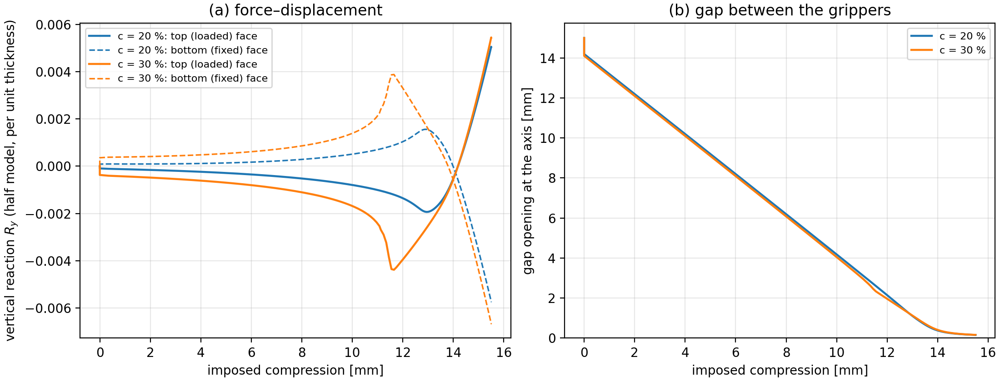

# Finite element simulations of the binary sensor

Finite element model and parametric study of the magneto-mechanical binary sensor of

> J. Crespo-Miguel, R. Ortigosa, M. L. Lopez-Donaire, J. Pernas-Sanchez, J. Martinez-Frutos, D. Garcia-Gonzalez.
> *Piezoresistive Binary Sensors Through Residual Magnetisation.* Submitted to Nature Communications.

The database these simulations produce trains the neural-network surrogate of [`../NN_surrogate`](../NN_surrogate).

Two hard-magnetic grippers with residual magnetisation face each other across a gap inside a
deformable air domain. The device is compressed by a prescribed displacement; the magnetic attraction
between the grippers closes the gap, and the reaction forces on the loaded faces and the displacement
of the gap corners are recorded along the load path. The study sweeps the gripper width `w`, the gap
`e` and the particle concentration of the magnetic material.

The problem is a monolithic magneto-mechanical formulation (displacement and scalar magnetic
potential) solved with [HyperFEM](https://github.com/MultiSimOLab/HyperFEM.jl) on
[Gridap](https://github.com/gridap/Gridap.jl), with the assembly delegated to the compiled, threaded
kernels of [HyperFEMKernels](https://github.com/MultiSimOLab/HyperFEMKernels.jl).

## Contents

```
Project.toml / Manifest.toml      Julia environment (Julia ≥ 1.12, HyperFEM 0.2, HyperFEMKernels 0.1.2)
README.md
src/
  gripper_sensor.jl               sensor_model(...): constitutive models, weak forms, solver and
                                  post-processing of one configuration; run_case(...) solves it
  parametric_study.jl             driver of the study: meshes, 25 geometries × 2 concentrations
data/models/
  mesh_generation.jl              Gmsh geometry and mesh of the device (the .msh files are written here)
data/sims/                        results, one JSON file per configuration
data/visualization/
  render_frames.py                ParaView script: frames of the animation of one configuration
  plot_force_displacement.py      force–displacement curve and gap opening from the result files
bench/                            timing script and comparison of two result files
```

## Installation

Julia 1.12 or later is required. From this folder (`FE_simulations`):

```bash
julia --project=. -e 'using Pkg; Pkg.instantiate()'
```

All the dependencies, HyperFEM and HyperFEMKernels included, are registered Julia packages.

## Running the study

```bash
julia --project=. -t auto src/parametric_study.jl
```

The script

1. generates the 25 meshes in `data/models/` (`w ∈ {5, 5.5, 6, 6.5, 7}`, `e ∈ {2, 2.25, 2.5, 2.75, 3}`,
   `αgrip = 1.0`), reusing the ones already present;
2. solves the 50 configurations (25 geometries × 2 concentrations, `c = 20 %` and `c = 30 %`), several at a
   time (`concurrent` in the script, half the number of Julia threads by default): the assembly kernels of
   all of them share the Julia threads (`-t N`) and the sparse LU of each case, which is serial, overlaps
   with the others;
3. writes the results to `data/sims/SmallMagnet_ParametricStudy/results_SmallDevice_w_*_e_*_αgrip_1.0_c_*.json`.

Every JSON file holds, per converged load step `step` (the load factor Λ ∈ [0, 1]), the reactions on
the top and bottom loaded faces `t_top`, `t_bottom` (vectors `[Rx, Ry]`) and the vertical displacement of
the four corners of the gap `uy_top_right`, `uy_bottom_right`, `uy_top_left`, `uy_bottom_left`.

A single configuration can be run from the REPL (`include` the `using` block and the two `include`
lines of `src/parametric_study.jl` first; `verbose=1` prints a line per load step, `verbose=2` every
Newton iteration):

```julia
geomodel = GmshDiscreteModel(gripper_mesh(5.0, 2.0, 1.0; dir="data/models"))
run_case(geomodel, 5.0, 2.0, 1.0, 20.0; simdir="data/sims", paraview=true, verbose=1)
```

With `paraview=true` a `.vtu` file is written at every converged step (displacement, potential, spatial
magnetic field `h = F⁻ᵀℋ₀`, its magnitude, Jacobian of the deformation and material region of every cell),
collected in `Results.pvd`; `data/visualization/render_frames.py` turns them into the frames of an animation.

<p align="center"></p>
<p align="center"><em>Configuration w = 5 mm, e = 2 mm: vertical reaction on the loaded and fixed faces (half model, per
unit thickness) and opening of the gap against the imposed compression, for 20 % and 30 % particle concentration.</em></p>

## Model and solver

- Grippers: Mooney–Rivlin hyperelasticity; the magnetic parts carry a hard-magnetic model with a
  remanent magnetisation that scales with the particle concentration, ramped up over the first 10 %
  of the load path. The soft (non-magnetic) part of the grippers is 20 times softer.
- Air: ideal magnetic medium; the Maxwell stress of the air acts on the solid as a traction on the
  solid–air interface, evaluated at the start of every load step. The mesh of the air follows the solid
  with a fictitious ARAP hyperelastic model stabilised by a gradient-jump penalty on its interior facets.
- Newton–Raphson with the consistent tangent (including the magneto-mechanical coupling blocks of both the
  mechanical and the magnetic equations) and quadratic convergence; when the line search fails the
  mechanical tangents are projected (eigenvalues clamped from below) until the residual drops
  (`HybridTangent` of HyperFEM). Injectivity-preserving line search (`det F > 0` at every quadrature point)
  and sparse LU solver (2D, ~32k dofs).
- Adaptive load stepping: increments of at most 1/500 of the load path, bisected on failure and grown back
  after easy steps, each one starting from the Dirichlet projection of the new boundary values.

## Performance

Full load path (Λ from 0 to 1), configuration `w = 5, e = 2` (31 683 dofs), Apple M5 Max, 18 Julia threads:

| | c = 20 % | c = 30 % |
|---|---|---|
| load increments (bisections) | 509 (15) | 501 (1) |
| Newton iterations | 1188 | 1237 |
| total time (including compilation) | 8.8 min | 8.6 min |
| peak resident memory | 6.5 GB | 6.6 GB |

The full parametric study (50 configurations) takes about seven hours run one after the other, less with
several configurations at a time. With the adaptive increments, the difference with a solution computed with
10 times smaller increments is 0.04 % in the gap displacements and 1–3 % in the reactions (the first-order
error of the Maxwell traction, evaluated once per increment).

## Citation

If you use these scripts, please cite the paper above (BibTeX entry in the [main README](../README.md#citation)).

## Contact

Jesús Martínez-Frutos (jesus.martinez@upct.es), MultiSimO Lab, Universidad Politécnica de Cartagena.
