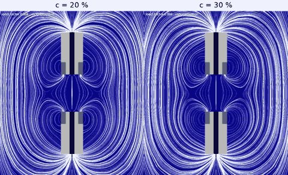

# SoftMagnetoSensing

Simulation code and data of

> J. Crespo-Miguel, R. Ortigosa, M. L. Lopez-Donaire, J. Pernas-Sanchez, J. Martinez-Frutos, D. Garcia-Gonzalez.
> *Piezoresistive Binary Sensors Through Residual Magnetisation.* Submitted to Nature Communications.

The sensor is a pair of hard-magnetic grippers with residual magnetisation facing each other across a
gap. Under compression the magnetic attraction closes the gap and switches a conductive pathway on and
off: a binary, piezoresistive response set by the geometry and the particle concentration of the device.

<p align="center">
  
</p>
<p align="center"><em>Finite element simulation of the sensor (gripper width w = 5 mm, gap e = 2 mm) with 20 % (left) and 30 % (right) particle concentration: the remanent magnetisation ramps up, then the device is compressed until the grippers snap into contact. Magnetic field lines and field magnitude (log scale) in the air; soft part of the grippers in light grey, hard-magnetic materials in black and dark grey.</em></p>

The repository has two independent parts, each with its own Julia environment (`Project.toml` /
`Manifest.toml`, versions pinned) and its own README with further detail:

| Folder | Content |
|---|---|
| [`FE_simulations/`](FE_simulations/) | Finite element model of the sensor (magneto-mechanics with explicit air, [HyperFEM](https://github.com/MultiSimOLab/HyperFEM.jl) on [Gridap](https://github.com/gridap/Gridap.jl)) and the parametric study over the gripper width, the gap and the particle concentration that generates the database of the paper |
| [`NN_surrogate/`](NN_surrogate/) | Neural-network surrogate trained on the finite element database, Sobol' sensitivity analysis and gradient-based inverse design (Fig. 4 and Supplementary Section S3) |

## Repository layout

### `FE_simulations/` — finite element simulations

| Path | Content |
|---|---|
| `Project.toml`, `Manifest.toml` | Julia environment (Julia ≥ 1.12): HyperFEM 0.2, HyperFEMKernels 0.1, Gridap 0.19.9, GridapGmsh, JSON |
| `src/gripper_sensor.jl` | The model. `sensor_model(geomodel, w, e, αgrip, c; ...)` builds the constitutive models (air, soft part of the grippers, two hard-magnetic materials), the boundary conditions, the weak forms (monolithic displacement–magnetic potential problem, Maxwell traction on the solid–air interface, gradient-jump stabilisation of the air), the Newton–Raphson solver with an injectivity-preserving line search, and the post-processing. `run_case(...)` builds the model and solves it along the load path (adaptive load increments, 1/500 at most) |
| `src/parametric_study.jl` | The full study: generates the meshes and solves the 50 configurations (5 widths `w` × 5 gaps `e` × 2 concentrations), several at a time |
| `data/models/mesh_generation.jl` | Gmsh geometry and mesh of the device, `gripper_mesh(w, e, αgrip; dir)`; the `.msh` files are written to this folder |
| `data/sims/` | Results, one JSON file per configuration: load factor `step` (Λ), reactions `t_top`, `t_bottom` on the loaded faces (vectors `[Rx, Ry]`) and vertical displacements of the four corners of the gap (`uy_top_right`, `uy_bottom_right`, `uy_top_left`, `uy_bottom_left`). Not tracked by git |
| `data/visualization/render_frames.py` | ParaView (`pvbatch`) script rendering the frames of the animation of one configuration from its `.vtu` files |
| `data/visualization/plot_force_displacement.py` | Force–displacement curve and gap opening of one or several configurations from their result files |
| `bench/run_case.jl` | One configuration with a timing and memory report |
| `bench/compare.py` | Comparison of two result files (maximum difference per quantity) |
| `README.md` | Model, solver and performance |

### `NN_surrogate/` — neural-network surrogate

| Path | Content |
|---|---|
| `Project.toml`, `Manifest.toml`, `requirements.txt` | Julia environment (Julia ≥ 1.10, Flux 0.16) and the Python packages of the figures (numpy, matplotlib) |
| `data/fe_database.csv`, `data/fe_database.bson` | Finite element database: 452 simulations, 7 design variables and 2 outputs (`u_On`, `u_Union`) |
| `models/surrogate_L4_N8.bson` | Released network (4 hidden layers of 8 tanh units) with its scaling constants, loss history and training split |
| `src/Surrogate.jl` | Curation, scaling, network, training, Sobol' indices, Gaussian-process baseline, inverse design |
| `scripts/example.jl` | Quick check: prediction of the held-out designs and one inverse-design problem |
| `scripts/train.jl` | Training from scratch |
| `scripts/si_analysis.jl` | Numbers and data of Supplementary Section S3 |
| `scripts/fig4_sensitivity.jl` | Sensitivity analysis and maps of Fig. 4c–e |
| `plotting/` | Python scripts of the Supplementary figures and of Fig. 4 |
| `results/`, `figures/` | Expected outputs and figures, to check a reproduction |

## Requirements

- Julia ≥ 1.12 for `FE_simulations` and Julia ≥ 1.10 for `NN_surrogate`. Every dependency is a registered
  Julia package.
- Python 3 with `numpy` and `matplotlib`, only for the figures of `NN_surrogate`.

## Running the finite element simulations

All commands are run from the `FE_simulations` folder.

**1. Installation** (first time only):

```bash
cd FE_simulations
julia --project=. -e 'using Pkg; Pkg.instantiate()'
```

**2. Full parametric study:**

```bash
julia --project=. -t auto src/parametric_study.jl
```

The script generates the meshes that are missing in `data/models/`, solves the 50 configurations (by
default half as many at a time as Julia threads; the assembly kernels of all of them share the threads and
the sparse LU of each case, which is serial, overlaps with the others) and writes the results to
`data/sims/SmallMagnet_ParametricStudy/`. Each configuration takes about nine minutes on a workstation (see
the performance section of [`FE_simulations/README.md`](FE_simulations/README.md#performance)).

**3. A single configuration** from the Julia REPL (`julia --project=. -t auto` in `FE_simulations`):

```julia
using HyperFEM, HyperFEMKernels
using HyperFEM.TensorAlgebra: regularize_hessian
using Gridap, GridapGmsh, Gridap.FESpaces, Gridap.CellData
using LinearAlgebra, JSON
BLAS.set_num_threads(1)
include("src/gripper_sensor.jl")
include("data/models/mesh_generation.jl")

geomodel = GmshDiscreteModel(gripper_mesh(5.0, 2.0, 1.0; dir="data/models"))
run_case(geomodel, 5.0, 2.0, 1.0, 20.0; simdir="data/sims", verbose=1)
```

Keywords of `run_case`:

| Keyword | Default | Meaning |
|---|---|---|
| `verbose` | `1` | `0` silent, `1` one line per load step, `2` every Newton iteration |
| `paraview` | `false` | `true` writes a `.vtu` file per converged step (displacement, potential, spatial magnetic field, its magnitude, Jacobian of the deformation, material region), collected in `Results.pvd` |
| `nsteps`, `grow`, `easy`, `maxbisec` | `500`, `2.0`, `5`, `10` | adaptive load stepping: the increment starts at `1/nsteps`, a failed increment is bisected (at most `maxbisec` consecutive times) and the increment grows by `grow` (up to `1/nsteps`) after a step converged in at most `easy` Newton iterations |
| `ProjectDirichlet` | `true` | every increment starts from the Dirichlet projection of the new boundary values, cut by the injectivity-preserving factor (`det F > 0`) |
| `backend` | `:compiled` | `:compiled` (threaded kernels of HyperFEMKernels) or `:lazy` (Gridap's assembly) |
| `newton` | `(maxiter=40, atol=1e-9, rtol=1e-6)` | stopping criteria of the Newton–Raphson solver |
| `tangent`, `atol_projected` | `:hybrid`, `1e-8` | consistent tangent, switched to the projected (positive-definite) mechanical tangent only when the line search fails, with the absolute tolerance `atol_projected` in that mode; `:projected` projects it always |
| `T₀`, `uapplied` | `0.1`, `15.5` | fraction of the load path over which the remanent magnetisation ramps up; applied compression (mm) |

**4. A single configuration with a timing and memory report:**

```bash
julia --project=. -t 18 bench/run_case.jl 1 1 20 500 compiled 100000
```

Arguments: index of `w` (1–5), index of `e` (1–5), concentration (%), `nsteps`, backend, and the number of
converged steps after which the run stops (`SMS_VTK=1` in the environment also writes the `.vtu` files).

**5. Animation and force–displacement curve** of a configuration run with `paraview=true` (ParaView 5.12 or
later for `pvbatch`, `ffmpeg` to assemble the video, Python 3 with `matplotlib`):

```bash
pvbatch data/visualization/render_frames.py <folder with Results.pvd> frames/
ffmpeg -framerate 30 -i frames/frame_%04d.png -c:v libx264 -pix_fmt yuv420p animation.mp4
python3 data/visualization/plot_force_displacement.py curve.png results_A.json:"c = 20 %" results_B.json:"c = 30 %"
```

## Running the neural-network surrogate

From the `NN_surrogate` folder (details and expected outputs in its README):

```bash
cd NN_surrogate
julia --project=. -e 'using Pkg; Pkg.instantiate()'
pip install -r requirements.txt
julia --project=. scripts/example.jl                                            # quick check
julia --project=. scripts/si_analysis.jl && python3 plotting/si_figures.py      # Supplementary Section S3
julia --project=. scripts/fig4_sensitivity.jl && python3 plotting/fig4_panels.py # Fig. 4c-e
julia --project=. scripts/train.jl [epochs] [seed]                              # training from scratch
```

## Citation

If you use this code or data, please cite:

J. Crespo-Miguel, R. Ortigosa, M. L. Lopez-Donaire, J. Pernas-Sanchez, J. Martinez-Frutos, D. Garcia-Gonzalez.
*Piezoresistive Binary Sensors Through Residual Magnetisation.* Submitted to Nature Communications (2026).

```bibtex
@unpublished{CrespoMiguel2026BinarySensors,
  author = {Crespo-Miguel, J. and Ortigosa, R. and Lopez-Donaire, M. L. and Pernas-Sanchez, J. and
            Martinez-Frutos, J. and Garcia-Gonzalez, D.},
  title  = {Piezoresistive Binary Sensors Through Residual Magnetisation},
  note   = {Submitted to Nature Communications},
  year   = {2026}
}
```

## License

MIT, see [`LICENSE`](LICENSE).

## Contact

Jesús Martínez-Frutos (jesus.martinez@upct.es), MultiSimO Lab, Universidad Politécnica de Cartagena.
